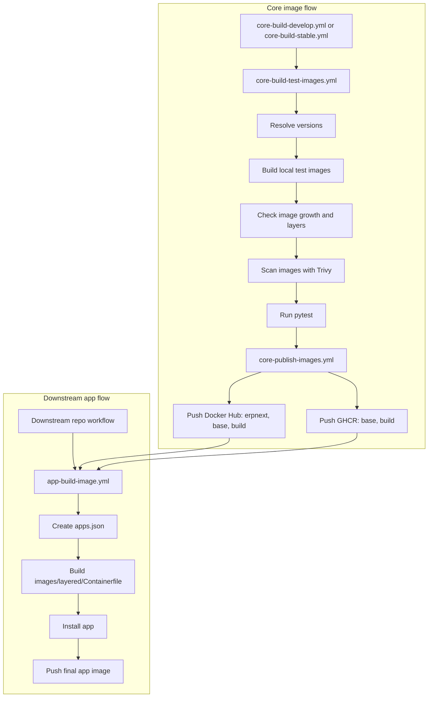

This document describes the current workflow setup for shared core images and reusable downstream app images.

# Workflow roles

The current workflow layout is:

- `.github/workflows/core-build-develop.yml`
- `.github/workflows/core-build-stable.yml`
- `.github/workflows/core-build-test-images.yml`
- `.github/workflows/core-publish-images.yml`
- `.github/workflows/app-build-image.yml`

`core-build-develop.yml` and `core-build-stable.yml` are orchestration workflows.
They decide when the core image pipeline runs.

`core-build-test-images.yml` is the reusable workflow that:

- resolves the image versions for the requested release line
- builds the shared core images into a local registry
- compares image sizes with a successful `main` baseline
- scans the locally built images with Trivy
- runs the test suite against those images

`core-publish-images.yml` is the reusable workflow that:

- publishes the tested images to Docker Hub
- publishes `base` and `build` to GHCR

`app-build-image.yml` is the reusable workflow that downstream repositories call to:

- create an `apps.json` file from the caller's app repository and ref
- build `images/layered/Containerfile`
- consume existing `base` and `build` images
- install the requested app into the final image
- optionally push the final app image to the caller's registry

# Current flow

The current structure is:

```text
core orchestration
  -> core build and test
  -> core publish

downstream app workflow
  -> consume published base and build
  -> install app
  -> publish final app image
```

Current Mermaid overview:



More concretely:

```text
core-build-test-images.yml
  -> resolves frappe and erpnext tags
  -> builds images into a local CI registry
  -> checks image growth and reports the largest layers
  -> scans the locally built images with Trivy
  -> runs tests

core-publish-images.yml
  -> pushes Docker Hub: erpnext, base, build
  -> pushes GHCR: base, build

app-build-image.yml
  -> pulls:
     - <prefix>/base:<frappe_ref>
     - <prefix>/build:<frappe_ref>
  -> installs app from app_repo + app_ref
  -> pushes final image_name:image_tag
```

# Automatic image size checks

The core build and test workflow measures `base`, `build`, and `erpnext` separately
for each release line and architecture. It reads the registry manifests and image
configuration already produced by the build. It does not download filesystem
layers or build a second reference image.

The architecture jobs run on matching native GitHub-hosted runners: `ubuntu-latest`
for amd64 and `ubuntu-24.04-arm` for ARM64. Each Bake build explicitly sets
`*.platform=linux/<architecture>`. Configuring the Buildx node's supported platforms
alone does not select the platform of the image being built. The measurement check
verifies the platform in both the manifest index and the image configuration.

The metric is the sum of **compressed filesystem layer sizes**, including inherited
base layers. It describes image download size, rather than Docker's local disk
usage. The job summary shows the baseline, current size, percentage change, layer
count, and the ten largest layers with their build instructions. Layer count alone
does not cause a failure.

Growth fails the build when it exceeds **both 5% and 100 MiB**. The limits live in
`.github/image-size-policy.json`; intentional larger increases require a reviewed
change to that policy. The size check runs before integration tests and the
dependent publishing jobs.

Every build saves a small `image-sizes-<repo>-<release-line>-<architecture>` report
artifact (PR report names include an extra `pr-` prefix). Only reports from a
**fully successful workflow run on `main` in this
repository**, using the same calling workflow, can become the next baseline.
Failed runs and pull requests are excluded, even if they uploaded measurements.
Both architecture reports must be present. Selection uses prior workflow runs, so
an older run finishing late cannot overwrite a newer baseline.
Lookup examines up to 500 recent baseline artifacts, ordered by workflow run ID.

This updates the baseline after successful image builds triggered by relevant
pushes to `main`, upstream releases, and the existing develop schedule. Pushes that
do not trigger image builds need no new measurements. No additional trigger,
manual run, or commit of generated measurements is required.

PR builds use the Frappe and ERPNext tags recorded in the baseline. Main and release
builds continue to resolve the latest application versions. When build inputs
change, the summary makes that explicit; the growth limit still applies. Moving
`develop` refs, mutable base images, and unpinned dependencies can also affect sizes,
so the comparison does not imply that all inputs are reproducible.

Reports are retained for 90 days. On the initial rollout, or after all eligible
reports expire, CI reports sizes without a numerical comparison. The next
successful `main` build supplies a baseline automatically. API or download failures
fail the check rather than silently discarding the baseline.

The lint workflow also checks **production, custom, and layered Containerfiles** for
recursive permission changes to the bench after it has been copied into a runtime
stage. Such changes can duplicate the bench in another image layer. Apply recursive
permissions in the builder before the copy; a nonrecursive permission change to the
bench directory itself is allowed. The same guard checks the built core images'
history. This guard works even before a numerical baseline exists.

Numeric size comparisons cover the production images that the core pipeline
already builds. Custom and layered recipes receive the permission guard; their
complete image sizes would require additional builds. The publishing workflow
currently rebuilds images after the test workflow, so these reports describe the
tested images rather than a verification of each published digest.

# Naming convention

GitHub Actions requires workflow files to stay directly inside `.github/workflows`.
Subdirectories are not supported for workflow files, so structure should come from file names and `name:` values.

Recommended file naming convention:

```text
<area>-<action>-<subject>.yml
```

Current examples:

- `core-build-bench.yml`
- `core-build-develop.yml`
- `core-build-stable.yml`
- `core-build-test-images.yml`
- `core-publish-images.yml`
- `app-build-image.yml`
- `docs-publish-site.yml`

Recommended visible workflow names:

- `Core / Build Bench`
- `Core / Build Develop`
- `Core / Build Stable`
- `Core / Build and Test Images`
- `Core / Publish Images`
- `App / Build Image`
- `Docs / Publish Site`

# Style rules

To keep workflows predictable, use one convention per category instead of mixing styles.

Workflow file names should use kebab-case:

```text
core-build-test-images.yml
app-build-image.yml
```

Workflow display names should use short title-style groups:

```text
Core / Build and Test Images
App / Build Image
```

Workflow inputs should use snake_case:

```yaml
app_name:
frappe_ref:
image_name:
```

Environment variables should use upper snake case:

```text
FRAPPE_IMAGE_PREFIX
PYTHON_VERSION
NODE_VERSION
```

The recommended rule set is:

- workflow file names: kebab-case
- workflow `name:` values: grouped title case
- workflow inputs: snake_case
- job ids and step ids: snake_case where practical
- environment variables: UPPER_SNAKE_CASE

This means `-` is preferred for file names, while `_` remains appropriate for YAML keys, inputs, and environment variables.

# Important inputs in `app-build-image.yml`

The reusable app workflow is controlled mainly by these inputs:

- `app_name`
  The application directory name, for example `crm`
- `app_repo`
  The Git repository to install, for example `frappe/crm`
- `app_ref`
  The branch or tag to install, for example `develop`
- `frappe_ref`
  The tag of the existing `base` and `build` images, for example `version-16`
- `frappe_image_prefix`
  Where the shared `base` and `build` images come from, for example `frappe` or `ghcr.io/frappe`
- `image_name`
  The final target image name, for example `ghcr.io/acme/crm`
- `image_tag`
  The final target image tag, for example `develop`
- `registry`
  The registry for the final push, for example `ghcr.io` or `docker.io`

The key distinction is:

```text
frappe_image_prefix = source of shared base/build images
image_name          = destination of the final app image
```

# Example: caller repository publishes to GHCR

This example assumes:

- shared base images exist in `ghcr.io/frappe/base` and `ghcr.io/frappe/build`
- the caller repository wants to publish its own app image to `ghcr.io/acme/crm`

```yaml
name: App / Build CRM Image

on:
  workflow_dispatch:
  push:
    branches:
      - develop

permissions:
  contents: read
  packages: write

jobs:
  build-image:
    uses: frappe/frappe_docker/.github/workflows/app-build-image.yml@main
    with:
      app_name: crm
      app_repo: acme/crm
      app_ref: develop
      frappe_ref: version-16
      frappe_image_prefix: ghcr.io/frappe
      image_name: ghcr.io/acme/crm
      image_tag: develop
      registry: ghcr.io
      push: true
      platforms: linux/amd64
```

What happens:

```text
1. app-build-image.yml is called
2. apps.json is generated from acme/crm + develop
3. the workflow builds images/layered/Containerfile
4. layered uses:
   - ghcr.io/frappe/build:version-16
   - ghcr.io/frappe/base:version-16
5. CRM is installed
6. the final image is pushed to ghcr.io/acme/crm:develop
```

For GHCR, the caller workflow should grant:

- `permissions: packages: write`

The reusable workflow then logs in with the workflow token.

# Example: caller repository publishes to Docker Hub

This example assumes:

- shared base images come from Docker Hub under `frappe`
- the caller repository wants to publish its app image to Docker Hub as `acme/crm`

```yaml
name: App / Build CRM Image

on:
  workflow_dispatch:
  push:
    branches:
      - develop

jobs:
  build-image:
    uses: frappe/frappe_docker/.github/workflows/app-build-image.yml@main
    with:
      app_name: crm
      app_repo: acme/crm
      app_ref: develop
      frappe_ref: version-16
      frappe_image_prefix: frappe
      image_name: acme/crm
      image_tag: develop
      registry: docker.io
      push: true
      platforms: linux/amd64
    secrets:
      REGISTRY_USERNAME: ${{ secrets.DOCKERHUB_USERNAME }}
      REGISTRY_PASSWORD: ${{ secrets.DOCKERHUB_TOKEN }}
```

In this case:

- shared images are pulled from `frappe/base:version-16` and `frappe/build:version-16`
- the final image is pushed to Docker Hub as `acme/crm:develop`
