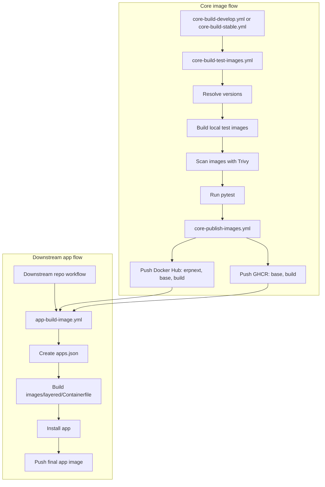

# Image build and release pipeline

The image pipeline separates shared core images from downstream app images. This page explains how building, testing, and publishing those images fit together.

For caller instructions, see [Build app images with GitHub Actions](../11-how-to/09-build-app-images-with-github-actions.md). The [app build workflow reference](../12-reference/02-app-build-workflow.md) defines the caller inputs, secrets, and permissions.

## Workflow roles

The current workflow layout is:

- `.github/workflows/core-build-develop.yml`
- `.github/workflows/core-build-stable.yml`
- `.github/workflows/core-build-test-images.yml`
- `.github/workflows/core-publish-images.yml`
- `.github/workflows/app-build-image.yml`

`core-build-develop.yml` and `core-build-stable.yml` are orchestration workflows.
They decide when the core image pipeline runs.

`core-build-test-images.yml` is the reusable workflow that:

- resolves the image versions for the requested release line
- builds the shared core images into a local registry
- scans the locally built images with Trivy
- runs the test suite against those images

`core-publish-images.yml` is the reusable workflow that:

- publishes the tested images to Docker Hub
- publishes `base` and `build` to GHCR

`app-build-image.yml` is the reusable workflow that downstream repositories call to:

- create an `apps.json` file from the caller's app repository and ref
- build `images/layered/Containerfile`
- consume existing `base` and `build` images
- install the requested app into the final image
- optionally push the final app image to the caller's registry

## Current flow

The current structure is:

```text
core orchestration
  -> core build and test
  -> core publish

downstream app workflow
  -> consume published base and build
  -> install app
  -> publish final app image
```

Current Mermaid overview:



More concretely:

```text
core-build-test-images.yml
  -> resolves frappe and erpnext tags
  -> builds images into a local CI registry
  -> scans the locally built images with Trivy
  -> runs tests

core-publish-images.yml
  -> pushes Docker Hub: erpnext, base, build
  -> pushes GHCR: base, build

app-build-image.yml
  -> pulls:
     - <prefix>/base:<frappe_ref>
     - <prefix>/build:<frappe_ref>
  -> installs app from app_repo + app_ref
  -> pushes final image_name:image_tag
```
