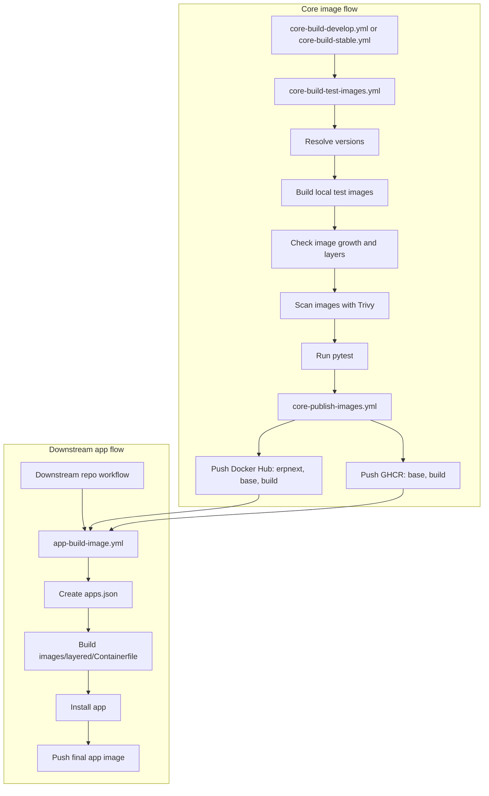

# Image build and release pipeline

The image pipeline separates shared core images from downstream app images. This page explains how building, testing, and publishing those images fit together.

For caller instructions, see [Build app images with GitHub Actions](../11-how-to/09-build-app-images-with-github-actions.md). The [app build workflow reference](../12-reference/02-app-build-workflow.md) defines the caller inputs, secrets, and permissions.

## Workflow roles

The current workflow layout is:

- `.github/workflows/core-build-develop.yml`
- `.github/workflows/core-build-stable.yml`
- `.github/workflows/core-build-test-images.yml`
- `.github/workflows/core-publish-images.yml`
- `.github/workflows/app-build-image.yml`

`core-build-develop.yml` and `core-build-stable.yml` are orchestration workflows.
They decide when the core image pipeline runs.

`core-build-test-images.yml` is the reusable workflow that:

- resolves the image versions for the requested release line
- builds the shared core images into a local registry
- compares image growth with a successful earlier `main` build
- scans the locally built images with Trivy
- runs the test suite against those images

The existing architecture matrix uses matching native runners and selects the
same platform for Bake, Trivy, and the CI Compose services. This keeps builds,
scans, tests, and size reports aligned with each job's intended architecture.

`core-publish-images.yml` is the reusable workflow that:

- rebuilds the resolved application versions and publishes images to Docker Hub
- publishes `base` and `build` to GHCR

`app-build-image.yml` is the reusable workflow that downstream repositories call to:

- create an `apps.json` file from the caller's app repository and ref
- build `images/layered/Containerfile`
- consume existing `base` and `build` images
- install the requested app into the final image
- optionally push the final app image to the caller's registry

## Current flow

The current structure is:

```text
core orchestration
  -> core build and test
  -> core publish

downstream app workflow
  -> consume published base and build
  -> install app
  -> publish final app image
```

Current Mermaid overview:



More concretely:

```text
core-build-test-images.yml
  -> resolves frappe and erpnext tags
  -> builds images into a local CI registry
  -> checks image growth and reports the largest layers
  -> scans the locally built images with Trivy
  -> runs tests

core-publish-images.yml
  -> pushes Docker Hub: erpnext, base, build
  -> pushes GHCR: base, build

app-build-image.yml
  -> pulls:
     - <prefix>/base:<frappe_ref>
     - <prefix>/build:<frappe_ref>
  -> installs app from app_repo + app_ref
  -> pushes final image_name:image_tag
```

## Image size regressions

An image can pass integration tests while carrying an unnecessary second copy of
its application files. A permission change after copying the bench into the
runtime image can add its files to another layer. Counting layers alone does not
show how much data each instruction adds.

The core pipeline therefore compares compressed layer sizes with a report from a
successful earlier `main` run and shows the largest layers with their build
instructions. Reusing measurements from existing builds keeps the comparison
automatic without adding a second reference build. PR and failed-run reports
cannot become baselines. Release lines and architectures have separate baselines,
and PR builds reuse their baseline's application tags to reduce unrelated changes.

The [image size check reference](../12-reference/06-image-size-checks.md) describes
thresholds, reports, baseline selection, and coverage for the existing core builds.

Publishing is a separate build after the tests. Size reports describe the tested
images; they do not verify that every published digest is identical to the tested
one.
